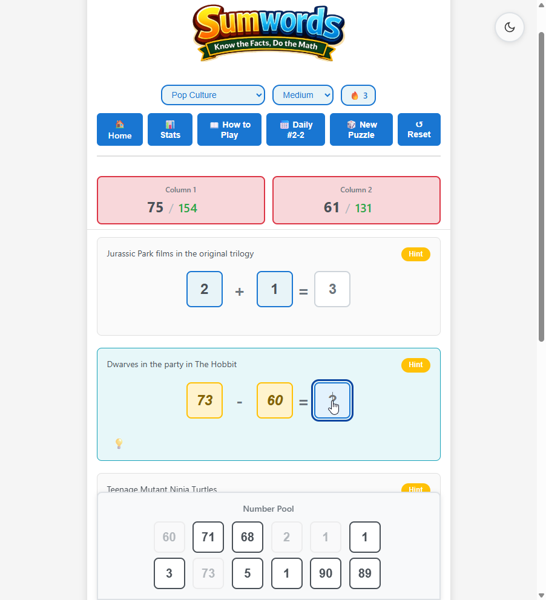

# Sumwords

[](https://github.com/thebimsider/sumwords/releases/latest)
[](https://github.com/thebimsider/sumwords/blob/main/LICENSE)
[](LICENSE)

[](https://thebimsider.github.io/sumwords/)

**"Know the Facts, Do the Math"**

A constraint-based math puzzle game that combines trivia knowledge with equation solving. Answer trivia questions by placing numbers from a limited pool into mathematical equations while satisfying column sum constraints.

**Landing Page:** [🏠 Home of Sumwords](https://thebimsider.github.io/sumwords/landing/)

## 🎮 Play Now

**Sumwords:** [🎲 Play Game](https://thebimsider.github.io/sumwords/V01/)

<p align="center">
  
  <br />
  <em>Sumwords in action</em>
</p>

## ✨ Features

### Core Gameplay

- **Three Difficulty Levels**
  - **Easy:** Addition/subtraction with numbers up to 50, 10 numbers, no decoys
  - **Medium:** Addition/subtraction with numbers up to 100, 12 numbers and 2 decoys
  - **Hard:** All four operators (+, −, ×, ÷) with numbers up to 200, 16 numbers and 6 decoys
- **Random Difficulty Mode:** Game randomly selects difficulty for variety
- **500 Trivia Questions** across 10 diverse categories
- **Constraint-Based Puzzles:** Numbers must satisfy both equations AND column totals

### Categories

1. Sports
2. History
3. Geography
4. Pop Culture
5. Science
6. Movies & TV
7. Food & Drink
8. Technology
9. Games & Literature
10. Animals & Nature

Plus an **"Everything"** category that combines all questions for maximum variety.

### Game Features

- **Interactive Tutorial:** First-time users see a helpful tutorial explaining gameplay with a "Don't show again" option
- **Dark Mode:** Toggle between light and dark themes with persistent preference
- **Hint System:** Every equation has its own Hint button; tap it to choose one of two hints
  - Reveal the answer to the trivia question
  - Reveal which numbers to place in the equation
- **Smart Resume:** Automatically saves progress and offers to resume unfinished puzzles
- **Statistics Tracking:** Track completed puzzles, attempts, hints used, perfect games, and win streaks
- **Share Results:** After a win, copy a spoiler-free, Wordle-style grid of your attempts to the clipboard; an equation solved with a hint shows as a yellow square
- **Daily Puzzle:** One shared puzzle per day (Everything, Medium) from a seeded generator, so everyone gets the same puzzle with no server; play it once per day and share your result as `Daily #1-12`
- **Mobile-Optimized:** Fully responsive design works great on phones and tablets
- **Persistent Storage:** Game state, preferences, stats, and theme saved locally

### Visual Polish

- Professional logo and branding
- Dark mode with smooth theme transitions
- Confetti animation on puzzle completion
- Color-coded validation feedback
- Emoji markers show which hints have been used
- Clean, modern interface

## 🎯 How to Play

### Goal

Place numbers from the number pool into the equation blanks to make valid equations. The sum of each column must match the target shown at the top.

### Rules

1. **Answer the trivia question** to learn which number is the solution
2. **Place numbers** from the pool into equation blanks by clicking the pool number, then clicking a blank. Operators are shown in every equation and are never blanks.
3. **Satisfy constraints:**
   - Each equation must be mathematically correct
   - Column totals must match the targets at the top
4. **Submit** when all blanks are filled. Each equation gets a mark (✓ Correct, ✗ Numbers don't work, ✗ Answer doesn't fit the question, … Incomplete) and each column target gets a ✓ or ✗. The trivia answer is never shown

### Tips

- Start by placing the answer to the trivia question
- Work backwards from column totals to narrow down number choices
- Use hints strategically if you get stuck
- Each number can only be used once

## 🛠️ Technology Stack

- **HTML5** - Semantic structure
- **CSS3** - Responsive design with CSS custom properties for theming
- **Vanilla JavaScript** - No frameworks or dependencies
- **localStorage API** - Persistent data storage for game state and preferences

## 📦 Installation (Local Development)

1. **Clone the repository**

```bash
   git clone https://github.com/TheBIMsider/sumwords.git
   cd sumwords
```

2. **Open in browser**

```bash
   # Simply open V01/index.html in your web browser
   # No build process or dependencies required
```

3. **Optional: Use a local server**

```bash
   # Python 3
   python -m http.server 8000

   # Node.js (if you have http-server installed)
   npx http-server -p 8000
```

Then navigate to `http://localhost:8000/V01/`

## 📁 Project Structure

```
sumwords/
├── V01/
│   ├── index.html          # Game HTML structure
│   ├── styles.css          # Game styling with dark mode
│   ├── game.js             # Game logic and 500 trivia questions
│   ├── Sumwords_Logo.png   # Game logo
│   └── README.md           # Copy of this README for the game folder
├── landing/
│   ├── index.html          # Landing page HTML
│   ├── styles.css          # Landing page styling with dark mode
│   ├── script.js           # Landing page theme switcher
│   ├── Sumwords_Logo.png   # Landing page logo
│   └── Sumwords_in_Action.png  # Landing page screenshot
├── tests/
│   ├── daily.test.js       # Checks the daily puzzle: same date same puzzle, numbering, share header and daily stats
│   ├── feedback.test.js    # Checks the Submit mark for each equation and that no trivia answer is printed
│   ├── generator.test.js   # Checks every generated puzzle is solvable, plus question bank rules
│   ├── hints.test.js       # Checks every equation has its Hint button and choice row, and old hint code is gone
│   ├── play-polish.test.js # Checks the Reset/New Puzzle confirm rules and auto-advance lookup
│   ├── share.test.js       # Checks the share text and per-attempt results
│   └── validation.test.js  # Checks Submit validation messages
├── README.md               # This file
└── LICENSE                 # BSD 3-Clause License
```

## 🎲 Game Design

### Puzzle Generation

- Questions are randomly selected from the chosen category
- Equations are generated using a "from" approach (targets calculated from equations)
- Number pools hold the two operands of every equation (the trivia answer is typed into its own blank)
- Decoy numbers (Medium/Hard) are extra pool numbers that belong to no equation, adding strategic complexity

### Difficulty Scaling

Every level has 5 equations. Operators are always visible.

- **Easy:** Numbers up to 50, addition/subtraction only, 10 numbers in a 5×2 pool grid, no decoys
- **Medium:** Numbers up to 100, addition/subtraction only, 12 numbers (2 decoys) in a 6×2 pool grid (3×4 mobile)
- **Hard:** Numbers up to 200, all operators (+, −, ×, ÷), 16 numbers (6 decoys) in an 8×2 pool grid (4×4 mobile)

### Daily Puzzle

The 📅 Daily button in the header loads one puzzle per calendar day. Everyone who plays on the same date gets the same puzzle, with no server: the puzzle is built from a seed made from the date, so every device builds the same questions and numbers (the order of the tiles in the pool may differ).

- Always Everything and Medium; the category and difficulty selectors are locked while a daily is loaded
- Uses the player's local date, and is playable once per day. After a win the Daily button shows your result, Share result and "Next daily puzzle tomorrow"
- Numbered `series-day`, for example `#1-12`. The series number only goes up when a change alters the dailies (new questions or a generator change), and the day count starts again at 1
- Share text header is `Sumwords v1.1.0 · Daily #1-12`; the rest is the usual spoiler-free grid
- A daily win counts as a normal Medium win and also shows in the Daily Puzzles block in Stats (there is no separate daily streak)

## 📊 Statistics

The game tracks comprehensive statistics including:

- Total puzzles completed
- Total attempts
- Hints used
- Perfect games (no hints)
- Current and best win streaks
- Per-difficulty breakdowns
- Daily puzzle totals (completed, attempts, hints, perfect games, average attempts)

## 🤝 Contributing

Contributions are welcome! This is a personal learning project, but feel free to:

- Report bugs via GitHub Issues
- Suggest new features
- Submit pull requests for improvements
- Add new trivia questions

### Adding Trivia Questions

Questions are stored in `V01/game.js` in the `questionBanks` object, one array per category (`sports`, `history`, `geography`, `popculture`, `science`, `moviestv`, `fooddrink`, `technology`, `gamesliterature`, `animalsnature`). Each question needs:

- `question`: The trivia question text
- `answer`: Whole number answer. The existing bank uses answers from 2 to 400; the rules are enforced by `tests/generator.test.js`

Add it to the array for its category. Example, added to `science`:

```javascript
{ question: 'Bones in the adult human body', answer: 206 },
```

## 📄 License

This project is licensed under the **BSD 3-Clause License** - see the [LICENSE](LICENSE) file for details.

Copyright © 2026 Carl Storms (The BIMsider)

## 👤 Author (Vibe Coder)

**Carl Storms (The BIMsider)** With the help of his AI Buddy 🤖 **Claude Code**

- Role: Technical Success Manager, AECO Software
- Experience: 25+ years in AECO technology and BIM
- Project Start: December 25, 2025

## 🙏 Acknowledgments

- Inspired by constraint-based puzzle games
- Built with vanilla JavaScript for maximum maintainability
- Designed mobile-first for modern web users
- 21 development sessions documented from concept to deployment

## 📝 Development

This project was developed (Vibe Coded) over 21 sessions with Claude Chat and continues in Claude Code:

- Automated tests check that every generated puzzle is solvable and that Submit validation behaves
- Question bank fact-checked and kept within the generator's answer rules
- Beginner-friendly code for long-term maintainability
- Systematic testing and bug fixes
- CSS variable architecture for maintainable theming

## 🚀 Roadmap

### Completed ✅

- Core game mechanics
- Three difficulty levels plus random mode
- 500 trivia questions across 10 categories
- Hint system with two hint types (answer and numbers)
- localStorage persistence
- Statistics tracking
- Mobile-responsive design
- Cross-browser compatibility
- Professional logo and branding
- Dark mode with theme toggle
- Landing page with animations
- Interactive tutorial for first-time users
- v1.1.0: 5 equations and visible operators on every level, audited question bank, automated puzzle and validation tests, version shown in the game
- Share results: win panel with a spoiler-free, Wordle-style grid copied to the clipboard
- Daily puzzle: one shared puzzle per day from a seeded generator, with a daily number, finished-result view and daily statistics

### Potential Future Enhancements

- Keyboard navigation support
- Sound effects (optional)
- Additional question categories
- Leaderboards
- Progressive Web App (PWA) support
- Advanced tutorial with interactive walkthrough

---

**Enjoy playing Sumwords!** 🎮🧮

If you find a bug or have suggestions, please open an issue on GitHub.
